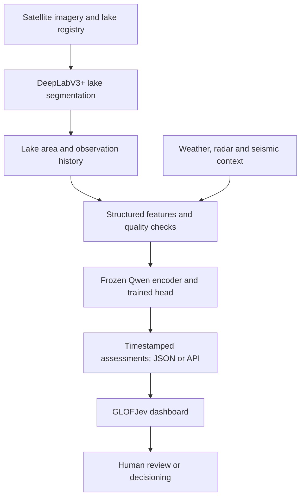

# GLOFJev

**Satellite-informed glacial lake monitoring and GLOF risk assessment**

*From changing glacial lakes to clearer, reviewable risk signals.*

GLOFJev is an AI-assisted research prototype for monitoring Himalayan glacial lakes and investigating **Glacial Lake Outburst Floods (GLOFs)**. It brings together satellite-image segmentation, lake-area history, environmental observations, and a **Qwen-based, JEV-inspired decision layer** in an interactive dashboard.

**[GitHub repository](https://github.com/DeveshIIITD/GLOF_JEV_AWS) · [Watch the demo](https://youtu.be/ks7QYWl4JVE) · [Showcase source](GLOFJev-showcase.html)**

| Project detail | Current status |
| --- | --- |
| Model training | AWS SageMaker |
| Demo deployment | Models and dashboard run locally |
| Intended use | Research, monitoring exploration, and demonstration |
| Demo video | [Watch GLOFJev on YouTube](https://youtu.be/ks7QYWl4JVE) |
| Repository | [DeveshIIITD/GLOF_JEV_AWS](https://github.com/DeveshIIITD/GLOF_JEV_AWS) |
| Showcase | [GLOFJev-showcase.html](GLOFJev-showcase.html), served locally |

> **Research prototype:** GLOFJev is not an operational flood-warning or evacuation system. It is just a prototype still under development.

## Contents

- [The problem](#the-problem)
- [Features](#features)
- [System architecture](#system-architecture)
- [Models and data](#models-and-data)
- [Technology stack](#technology-stack)
- [Project components](#project-components)
- [Getting started](#getting-started)
- [AWS usage and deployment](#aws-usage-and-deployment)
- [Demo walkthrough](#demo-walkthrough)
- [Evaluation and limitations](#evaluation-and-limitations)
- [Roadmap](#roadmap)
- [Author and acknowledgments](#author-and-acknowledgments)
- [Licenses and third-party notices](#licenses-and-third-party-notices)

## The problem

Glacial lakes can expand as mountain glaciers retreat. If a natural dam fails, the sudden release of water can threaten downstream communities, roads, hydropower facilities, and other infrastructure.

Monitoring these remote lakes is difficult: satellite observations have gaps, environmental conditions change, and useful evidence is spread across different sources. GLOFJev aims to make that evidence easier to inspect by showing **where a lake is changing, which contextual observations are available, and what deserves closer human review**.

## Features

| Feature | What it provides |
| --- | --- |
| Satellite-image processing | Processes available lake imagery, including Sentinel observations where configured. |
| Lake-water segmentation | Uses DeepLabV3+ with a ResNet-50 backbone to identify water pixels. |
| Lake-change monitoring | Estimates lake area within the processed imagery footprint and compares observations over time. |
| Environmental context | Associates available rainfall, temperature, radar, and seismic observations with data-quality checks. |
| Qwen–JEV assessment | Encodes structured features with a frozen Qwen backbone and applies a trained classification head. |
| Interactive dashboard | Displays mapped lakes, filters, time-series charts, CSV downloads, and regular/satellite map views. |
| Separate schematic page | Explains the processing workflow through an animated system schematic. |
| Reviewable outputs | Preserves timestamps and distinguishes predictions, insufficient data, and synthetic demonstrations. |

Feature availability depends on the configured data sources, credentials, model artifacts, and backend. The committed dashboard uses simulated observations when no API is configured, and falls back to those observations if an API request fails. Fresh results require the data and inference workflows to run and the dashboard API to be connected.

## System architecture



1. **Identify water:** DeepLabV3+ produces a lake-water mask from satellite imagery.
2. **Measure change:** The monitoring workflow estimates lake area, records acquisition details, and builds an observation history.
3. **Add context:** Available environmental observations are combined with lake features and checks for missing, stale, or low-quality data.
4. **Run the classifier:** A frozen Qwen encoder supplies embeddings to a trained classification head.
5. **Present the evidence:** The dashboard loads exported assessments or results from a connected API for human review.

## Models and data

### Lake segmentation

The segmentation component uses **DeepLabV3+ with a ResNet-50 backbone**. Its predicted water mask is converted into an area estimate within the processed scene or crop. Consistent preprocessing, spatial resolution, and acquisition metadata are needed when comparing measurements over time.

### Qwen-based, JEV-inspired classifier

The decision component uses a **frozen Qwen 2.5-series backbone** and a small trained classification head. The default in [config.py](config.py) is **`Qwen/Qwen2.5-1.5B-Instruct`**; the model ID and revision recorded with the trained checkpoint determine which backbone to load.

**“JEV-inspired” describes this project's local classifier.** The project does not use TypeSafe's proprietary JEV API or claim to reproduce its proprietary architecture.

### Training provenance

The prototype's Qwen classification-head workflow uses **synthetic demonstration labels**. These examples support software-pipeline development and demonstrations. Verified historical events and appropriately constructed non-event controls are needed to evaluate real forecasting performance.


### Required artifacts

| Artifact | Required material |
| --- | --- |
| DeepLab segmentation model | Trained `.keras` model and its preprocessing configuration; the inference notebook defaults to `models/deeplab/final_model.keras` |
| Qwen classification head | `glof_jev_head.pt` and `glof_jev_metadata.json` |
| Qwen backbone | The matching model ID and revision, downloaded or cached |
| Feature schema | Expected feature order, prompt format/version, quality checks, and any saved normalization or calibration parameters |
| Monitoring data | Lake registry, observation history, and the SQLite/CSV/JSON exports used by the selected workflow |

A classification-head checkpoint alone is not a complete standalone Qwen model. Store large model weights in an appropriate artifact or model store, and keep credentials out of the repository.

The current repository does not include the trained model files or the Qwen training/inference module. Supply those artifacts separately to reproduce model inference; the two committed notebooks cover DeepLab training and the combined monitoring/data-collection workflow.

## Technology stack

| Layer | Technologies |
| --- | --- |
| Image segmentation | Python, TensorFlow/Keras, DeepLabV3+, ResNet-50 |
| Decision model | PyTorch, Hugging Face Transformers, Qwen 2.5-series backbone |
| Data processing | NumPy, pandas, SciPy, scikit-learn, scikit-image, Matplotlib |
| Image and geospatial utilities | OpenCV, Pillow, Albumentations, Rasterio, Shapely, pyproj |
| Observation sources | Google Earth Engine, Sentinel imagery, Copernicus DEM, GLIMS, NASA GPM, Open-Meteo, USGS |
| Local persistence | SQLite, CSV, JSON/JSONL |
| Dashboard | Plain HTML, CSS, JavaScript, Leaflet 1.9.4, custom SVG charts |
| Map basemaps | OpenStreetMap and Esri World Imagery |
| AWS integration helpers | Boto3/Botocore, example S3-backed Lambda, Amplify configuration |
| Experimentation and training | Jupyter notebooks, AWS SageMaker |
| Current demo runtime | Local model inference and dashboard |

## Project components

Paths below match the public [GLOF_JEV_AWS repository](https://github.com/DeveshIIITD/GLOF_JEV_AWS). Preserve the capital **N** in `Notebooks` and the two nested `glofwatch-dashboard` directories when following the local instructions.

### Notebooks and Python helpers

| File | Purpose |
| --- | --- |
| [Notebooks/1_Train_DeepLab_on_SageMaker.ipynb](Notebooks/1_Train_DeepLab_on_SageMaker.ipynb) | Train/evaluate DeepLabV3+ segmentation, select a threshold, and save the model. |
| [Notebooks/2_DeepLab_Inference_and_Data_Access.ipynb](Notebooks/2_DeepLab_Inference_and_Data_Access.ipynb) | Load DeepLab, collect satellite/environmental observations, maintain the monitoring database, and prepare historical JEV candidate rows and label-review exports. |
| [Notebooks/3_Train_Qwen_Jev_on_SageMaker.ipynb](Notebooks/3_Train_Qwen_Jev_on_SageMaker.ipynb) | Train a three-class head over frozen Qwen embeddings, calibrate scores, evaluate against a numeric baseline, save artifacts, and check inference after reloading. |
| [config.py](config.py) | Shared configuration helpers for model paths, working files, Earth Engine, and optional AWS settings. |
| [features.py](features.py) | Feature formatting, target/label validation, synthetic examples, dataset splitting, calibration utilities, and measurement-quality checks. |
| [bridge.py](bridge.py) | Feature/snapshot handoff, Qwen-result merging, and database backup helpers. |
| [aws.py](aws.py) | S3 upload/download helpers and publishing of monitoring snapshots and artifacts. |
| [glofwatch_signature_fix (1).py](glofwatch_signature_fix%20%281%29.py) | Patch functions for use inside an already loaded monitoring notebook, including registry and measurement-signature handling. |

### Dashboard and showcase

The dashboard directory is **[glofwatch-dashboard/glofwatch-dashboard/](glofwatch-dashboard/glofwatch-dashboard/)**. Dashboard filenames in this table are relative to that directory.

| File or directory | Purpose |
| --- | --- |
| [index.html](glofwatch-dashboard/glofwatch-dashboard/index.html) | Main dashboard page. |
| [app.js](glofwatch-dashboard/glofwatch-dashboard/app.js) | Dashboard state, API requests, map layers, SVG charts, filters, and CSV export. |
| [styles.css](glofwatch-dashboard/glofwatch-dashboard/styles.css) | Dashboard layout and styling. |
| [config.js](glofwatch-dashboard/glofwatch-dashboard/config.js) | Public dashboard API endpoint configuration. |
| [schematic.html](glofwatch-dashboard/glofwatch-dashboard/schematic.html) | Separate animated system-schematic page. |
| [schematic.css](glofwatch-dashboard/glofwatch-dashboard/schematic.css) and [schematic.js](glofwatch-dashboard/glofwatch-dashboard/schematic.js) | Responsive schematic layout, animation controls, and navigation. |
| [assets/schematic/](glofwatch-dashboard/glofwatch-dashboard/assets/schematic/) | Bundled GIF icons and corresponding static PNGs. |
| [tools/generate_schematic_assets.py](glofwatch-dashboard/glofwatch-dashboard/tools/generate_schematic_assets.py) | Regenerate schematic assets with Pillow. |
| [aws/lambda_function.py](glofwatch-dashboard/glofwatch-dashboard/aws/lambda_function.py) | Example Lambda handler that reads dashboard assessments from S3. |
| [data/example-api-response.json](glofwatch-dashboard/glofwatch-dashboard/data/example-api-response.json) | Example JSON response for the dashboard API. |
| [amplify.yml](glofwatch-dashboard/glofwatch-dashboard/amplify.yml) | Optional AWS Amplify static-hosting build configuration. |
| [README.md](glofwatch-dashboard/glofwatch-dashboard/README.md) | Dashboard-specific API, map, schematic, and hosting instructions. |
| [GLOFJev-showcase.html](GLOFJev-showcase.html) — repository root | Presentation/showcase page for explaining the project. |

### Data and saved monitoring files

| File or directory | Purpose |
| --- | --- |
| [data/images/](data/images/) | Segmentation input images. |
| [data/masks/](data/masks/) | Segmentation masks. |
| [discovered_lake_registry.csv](discovered_lake_registry.csv) | Saved discovered-lake registry. |
| [glof_monitor.sqlite](glof_monitor.sqlite) | Saved monitoring database. |
| [glof_monitor.sqlite.measurement_signature.json](glof_monitor.sqlite.measurement_signature.json) | Measurement-signature sidecar associated with the monitoring database. |
| [features (1)](features%20%281%29) | JSONL feature export; the committed filename has no extension. |
| [jev_controls_REVIEW (1).csv](jev_controls_REVIEW%20%281%29.csv) | Non-event control-review template; review labels independently before exporting verified training rows. |

## Getting started

### Prerequisites

- Python 3 for serving the dashboard; a compatible TensorFlow environment for running the notebooks.
- The trained model artifacts and feature metadata described above.
- Imagery access and credentials for the external sources used by your run.
- Internet access for Earth Engine, observation feeds, and the dashboard's external map tiles/fonts.

Follow the dependency instructions in each notebook or package. TensorFlow and PyTorch/Qwen may require separate environments or kernels.

### 1. Open the static dashboard locally

Clone the repository and serve its root directory:

```bash
git clone https://github.com/DeveshIIITD/GLOF_JEV_AWS.git
cd GLOF_JEV_AWS
python -m http.server 8000
```

| Page | Local URL |
| --- | --- |
| Dashboard | [Open dashboard](http://localhost:8000/glofwatch-dashboard/glofwatch-dashboard/index.html) |
| Animated schematic | [Open schematic](http://localhost:8000/glofwatch-dashboard/glofwatch-dashboard/schematic.html) |
| Project showcase | [Open showcase](http://localhost:8000/GLOFJev-showcase.html) |

### 2. Run the monitoring and model workflow

1. Open [Notebooks/1_Train_DeepLab_on_SageMaker.ipynb](Notebooks/1_Train_DeepLab_on_SageMaker.ipynb) to train/evaluate segmentation. Update its dataset paths to the intended `data/images/` and `data/masks/` directories, or use your existing trained model.
2. Open [Notebooks/2_DeepLab_Inference_and_Data_Access.ipynb](Notebooks/2_DeepLab_Inference_and_Data_Access.ipynb). Set `PROJECT_DIR` to your repository/work directory, `MODEL_FILENAME` to the trained `.keras` filename, and `GEE_PROJECT` to your Earth Engine project. The notebook resolves the model under `PROJECT_DIR / "models" / "deeplab"`.
3. To reuse the committed registry, select `REGISTRY_MODE = "csv"` and point `REGISTRY_CSV` to `PROJECT_DIR / "discovered_lake_registry.csv"`. Follow the notebook's database-signature checks when reusing `glof_monitor.sqlite`.
4. Run the notebook's dependency, inference, monitoring, and historical-collection sections. Review event/non-event labels before enabling `RUN_LABEL_EXPORT`. The committed control template is named `jev_controls_REVIEW (1).csv`; update `CONTROL_LABELS_CSV` if using that file.
5. Run your separately supplied Qwen training/inference workflow with matching checkpoints, backbone, and feature metadata. The Python helpers do not constitute a complete model-serving backend on their own.
6. Connect the dashboard to the JSON results through a running API and verify timestamps, provenance labels, and insufficient-data flags.

### 3. Connect dashboard results through an API

Use [data/example-api-response.json](glofwatch-dashboard/glofwatch-dashboard/data/example-api-response.json) as the response-format reference. In [config.js](glofwatch-dashboard/glofwatch-dashboard/config.js), set `window.GLOF_API_URL` to the public base URL of your read-only results API. The dashboard requests `GET /lakes/latest`.

For the optional AWS route, [aws/lambda_function.py](glofwatch-dashboard/glofwatch-dashboard/aws/lambda_function.py) reads an exported snapshot from S3. The [dashboard README](glofwatch-dashboard/glofwatch-dashboard/README.md) describes its configuration and the API Gateway connection. Configure the API's CORS for the dashboard origin; keep AWS credentials out of frontend files.

## AWS usage and deployment

**AWS SageMaker was used for model training. The current demonstration runs the dashboard locally.**

## Demo walkthrough

**[Watch the project demo on YouTube](https://youtu.be/ks7QYWl4JVE).** The presentation page is [GLOFJev-showcase.html](GLOFJev-showcase.html).

1. **Problem:** Explain GLOFs and the need for accessible glacial-lake monitoring evidence.
2. **Satellite pipeline:** Show an actual image, its acquisition date, the DeepLab mask, and the measured lake area.
3. **Monitoring:** Inspect lake-area history and available environmental context.
4. **Assessment:** Show the Qwen-based output, its provenance, and any data-quality flags.
5. **Dashboard:** Demonstrate map views, filters, charts, CSV export, and the schematic page.
6. **Execution:** Show SageMaker training evidence and the locally running demonstration.


## Evaluation and limitations

Real-world evaluation requires:

- Independently verified event and non-event records with features available before each forecast cutoff.
- Held-out lakes/events and evaluation of recall, false alarms, calibration, and useful lead time.
- Quantified segmentation errors, including sensitivity to clouds, snow, shadows, and satellite revisit intervals.
- Checks for distribution shift and missing/stale data, with reproducible inference on the recorded model revision.
- Hydrological expertise, ground observations, reliable communications, and coordination with authorized warning agencies before operational use.

GLOFJev supports research and review. It must not be used as the sole basis for public warnings or evacuation decisions.

## Roadmap

- Build an independently reviewed historical event and non-event dataset.
- Validate lake segmentation and forecasting outputs on held-out observations.
- Improve handling of cloud cover, stale observations, and insufficient evidence.
- Implement and test a hosted inference API for fresh dashboard results.
- Work with hydrology and disaster-management experts on responsible escalation.

The intended impact is to connect **what changed in lake imagery** with **why an observation may need attention**, helping researchers and reviewers inspect evidence more efficiently.

## Author and acknowledgments

**Devesh Kumar** — Computer Science and Engineering student, **IIIT Delhi**.

- **Qwen / Alibaba Cloud:** Foundation-model family used by the local classifier.
- **Anubhab Banerjee's [Qwen-jev](https://github.com/AnubhabBanerjee/Qwen-jev):** Learning reference for JEV-inspired experimentation.
- **TypeSafe's JEV:** Background inspiration for structured decision outputs; no official affiliation or proprietary API access is claimed.
- **ChatGPT and Codex:** Assistance with research, coding, documentation, and showcase preparation.
- **Satellite and environmental-data providers:** Credit the sources used by each run and retain their required attribution.

## Licenses and third-party notices

### Original GLOFJev code

**Project license: not declared.** No repository-root `LICENSE` file was present in the inspected public repository. This README does not assign MIT, Apache-2.0, or another license to the original project code, documentation, or project-created checkpoints. If a project license is added, it must identify which materials it covers.

Third-party software, models, data, and media retain their respective licenses and terms. A future project license must identify which original materials it covers.

### Software licenses

The following notices cover dependencies observed in the committed notebooks/dashboard and the stated Qwen workflow. The upstream links provide full license texts; retain the notices shipped with the exact versions you distribute, including notices for bundled dependencies.

| Software | License | Full upstream license / notice |
| --- | --- | --- |
| Python | Python Software Foundation License Version 2; incorporated components have additional notices | [Python licenses and acknowledgments](https://docs.python.org/3/license.html) |
| TensorFlow | Apache-2.0, with additional incorporated-code notices | [TensorFlow LICENSE](https://github.com/tensorflow/tensorflow/blob/master/LICENSE) |
| Keras | Apache-2.0 | [Keras LICENSE](https://github.com/keras-team/keras/blob/master/LICENSE) |
| PyTorch | BSD-3-Clause; bundled components retain their own notices | [PyTorch LICENSE](https://github.com/pytorch/pytorch/blob/main/LICENSE) |
| Hugging Face Transformers | Apache-2.0 | [Transformers LICENSE](https://github.com/huggingface/transformers/blob/main/LICENSE) |
| NumPy | BSD-3-Clause | [NumPy LICENSE](https://github.com/numpy/numpy/blob/main/LICENSE.txt) |
| pandas | BSD-3-Clause | [pandas LICENSE](https://github.com/pandas-dev/pandas/blob/main/LICENSE) |
| SciPy | BSD-3-Clause | [SciPy LICENSE](https://github.com/scipy/scipy/blob/main/LICENSE.txt) |
| scikit-learn | BSD-3-Clause | [scikit-learn COPYING](https://github.com/scikit-learn/scikit-learn/blob/main/COPYING) |
| scikit-image | BSD-3-Clause primarily; retain file-specific notices | [scikit-image LICENSE](https://github.com/scikit-image/scikit-image/blob/main/LICENSE.txt) |
| Matplotlib | Matplotlib license agreement | [Matplotlib LICENSE](https://github.com/matplotlib/matplotlib/blob/main/LICENSE/LICENSE) |
| Pillow | MIT-CMU in current upstream; retain the installed release's license | [Pillow LICENSE](https://github.com/python-pillow/Pillow/blob/main/LICENSE) |
| Albumentations (`albumentations`) | MIT for the referenced upstream | [Albumentations LICENSE](https://github.com/albumentations-team/albumentations/blob/main/LICENSE) |
| OpenCV and `opencv-python-headless` | Current OpenCV core: Apache-2.0; Python packaging: MIT; bundled components have separate notices | [OpenCV LICENSE](https://github.com/opencv/opencv/blob/4.x/LICENSE), [Python packaging LICENSE](https://github.com/opencv/opencv-python/blob/4.x/LICENSE.txt) |
| Rasterio | BSD-3-Clause; retain GDAL/bundled-component notices | [Rasterio LICENSE](https://github.com/rasterio/rasterio/blob/main/LICENSE.txt) |
| Shapely | BSD-3-Clause; retain GEOS/bundled-component notices | [Shapely LICENSE](https://github.com/shapely/shapely/blob/main/LICENSE.txt) |
| pyproj | MIT; retain PROJ/bundled-component notices | [pyproj LICENSE](https://github.com/pyproj4/pyproj/blob/main/LICENSE) |
| Requests | Apache-2.0 | [Requests LICENSE](https://github.com/psf/requests/blob/main/LICENSE) |
| Boto3 and Botocore | Apache-2.0 | [Boto3 LICENSE](https://github.com/boto/boto3/blob/develop/LICENSE), [Botocore LICENSE](https://github.com/boto/botocore/blob/develop/LICENSE.txt) |
| Google Earth Engine API client | Apache-2.0, with incorporated-code notices | [Earth Engine API LICENSE](https://github.com/google/earthengine-api/blob/master/LICENSE) |
| SQLite core library | Public-domain dedication | [SQLite copyright notice](https://www.sqlite.org/copyright.html) |
| Jupyter Notebook | BSD-3-Clause; other Jupyter components have their own notices | [Jupyter Notebook LICENSE](https://github.com/jupyter/notebook/blob/main/LICENSE) |
| Leaflet 1.9.4 | BSD-2-Clause | [Leaflet 1.9.4 LICENSE](https://github.com/Leaflet/Leaflet/blob/v1.9.4/LICENSE) |

### Model and reference-code licenses

The Qwen backbone's license depends on the **exact model ID and revision**. The default model named in `config.py` has the following upstream license; if your trained metadata names a different model, use that model's own license instead.

| Model or source | License / status | Applicable reference |
| --- | --- | --- |
| `Qwen/Qwen2.5-Coder-1.5B-Instruct` | Apache-2.0 | [Configured Qwen backbone LICENSE](https://huggingface.co/Qwen/Qwen2.5-Coder-1.5B-Instruct/blob/main/LICENSE) |
| DeepLabV3+ / ResNet-50 implementation and pretrained weights | Source-specific; architecture names do not identify a code or weights license | Record the implementation source and pretrained-weight terms used by the segmentation notebook |
| Adapted code from the Qwen-jev learning reference, if any | Upstream license not verified | Check the license at the exact [Qwen-jev](https://github.com/AnubhabBanerjee/Qwen-jev) revision used; no upstream license is assigned here |
| Project-created classifier head and model artifacts | No separate license specified in the supplied material | Publish artifact-specific license and training-provenance information alongside any released checkpoints |

### Data, services, and visual assets

| Material or service | Terms and attribution |
| --- | --- |
| Copernicus Sentinel-1 and Sentinel-2 data | Follow the [Sentinel Data Legal Notice](https://sentinels.copernicus.eu/documents/247904/690755/Sentinel_Data_Legal_Notice). For redistributed unmodified data, use `Copernicus Sentinel data [Year]`; for modified data, use `Contains modified Copernicus Sentinel data [Year]`, with the relevant data year. See the [official attribution guidance](https://documentation.dataspace.copernicus.eu/FAQ.html). |
| Copernicus DEM GLO-30 | Follow the dataset-specific Copernicus DEM license and copyright notice linked in the [GLO-30 catalog entry](https://developers.google.com/earth-engine/datasets/catalog/COPERNICUS_DEM_GLO30); the Sentinel data notice does not replace the DEM terms. |
| GLIMS glacier outlines | Retain the GLIMS/NSIDC dataset citation and DOI specified in the [GLIMS catalog terms](https://developers.google.com/earth-engine/datasets/catalog/GLIMS_current). |
| NASA GPM IMERG V07 | NASA-produced GPM data is freely available for public use; credit the product and dataset DOI in the [IMERG V07 catalog](https://developers.google.com/earth-engine/datasets/catalog/NASA_GPM_L3_IMERG_V07). |
| Open-Meteo weather data and API | Data is CC-BY-4.0 with attribution; API access has separate usage conditions, including non-commercial conditions for the free API. Follow the [Open-Meteo terms](https://open-meteo.com/en/terms). |
| USGS earthquake observations | Follow the source-specific notices for the [USGS earthquake service](https://earthquake.usgs.gov/fdsnws/event/1/), and credit USGS and any identified contributing sources. |
| Google Earth Engine datasets | Follow each dataset's license and attribution in its [catalog entry](https://developers.google.com/earth-engine/datasets). Earth Engine access is separately governed by its [service terms](https://earthengine.google.com/terms/). |
| Saved lake registries, training images/masks, and historical-event labels | Retain source-level provenance and permissions. This README does not assign a blanket license to the committed dataset files or derived exports. |
| OpenStreetMap basemap | Map data is licensed under ODbL. Keep `© OpenStreetMap contributors` visible and follow the [copyright/attribution requirements](https://www.openstreetmap.org/copyright) and the separate [tile usage policy](https://operations.osmfoundation.org/policies/tiles/). |
| Esri World Imagery basemap | Provider-specific imagery terms apply. Preserve the credits already configured in `app.js` and consult the [World Imagery item and attribution](https://www.arcgis.com/home/item.html?id=10df2279f9684e4a9f6a7f08febac2a9). |
| DM Sans and Manrope fonts | SIL Open Font License 1.1. Retain the full notices if distributing font files: [DM Sans OFL](https://github.com/google/fonts/blob/main/ofl/dmsans/OFL.txt), [Manrope OFL](https://github.com/google/fonts/blob/main/ofl/manrope/OFL.txt). |
| External photographs, news images, GIFs, icons, and logos | Asset-specific permissions and attribution apply. Software and model licenses do not automatically cover these assets. |
| AWS and other hosted services | Access is governed by the relevant provider's service agreement. Hosting a project does not change the licenses of its code, models, or data. |

### Scope of these notices

This section documents the inspected source dependencies and identified data/map/font providers. It is not a complete inventory of every transitive dependency or embedded media asset. Match the notices to the installed package versions, actual trained-model revision, and source records for any redistributed data or media.

When redistributing third-party material, include the required full license texts, copyright notices, disclaimers, and any applicable `NOTICE` files with the distribution. The links and summaries above do not replace those files or grant additional rights.
